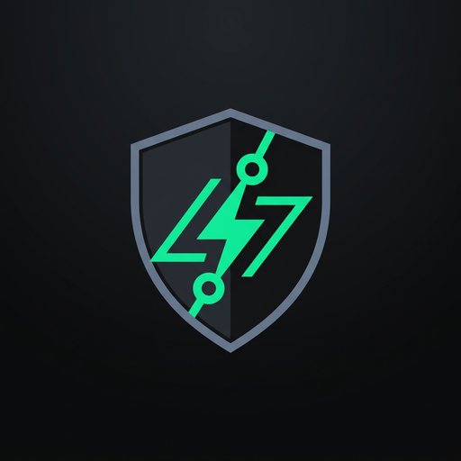
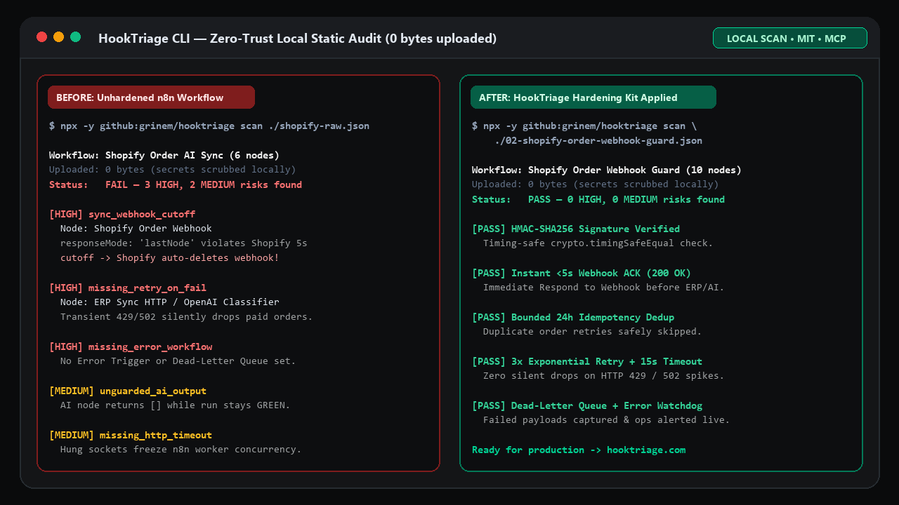
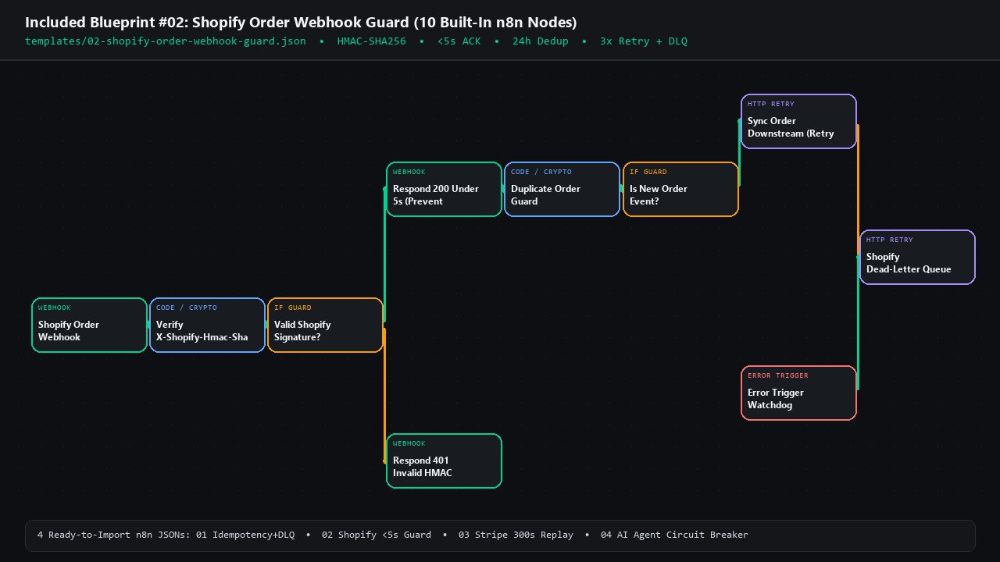

<p align="center">
  
</p>

# HookTriage CLI & Zero-Trust MCP Server

Audit n8n workflows, Shopify/Stripe webhook configs, and AI Agent pipelines **directly inside your terminal or AI IDE (Cursor, Claude Code, Antigravity, Windsurf)** with **0 bytes uploaded**.

---

## ⚡ Instant Usage (Zero Install)

```bash
npx -y github:grinem/hooktriage scan ./my-workflow.json
```

JSON output for CI checks:

```bash
npx -y github:grinem/hooktriage scan ./my-workflow.json --json
```

---

## 🔧 Pro Auto-Patch (`fix`) — 100% Offline

Free audit (always free, MIT):

```bash
npx -y github:grinem/hooktriage audit ./my-workflow.json
```

One-command auto-hardening of **your own** workflow (timeouts, retry/backoff, `errorWorkflow`, DLQ error branches, PII scrubber) — license key included in the Pro Kit:

```bash
npx -y github:grinem/hooktriage fix ./my-workflow.json --key=HT-PRO-...
```

The key is verified locally with an Ed25519 public key: **0 network calls, 0 bytes uploaded**.

---

## 🧱 Community Edition Blueprints (free, import in n8n via *Import from URL*)

| Blueprint | Import URL |
|---|---|
| Production Error Handler — Zero-Trust PII Scrubber, DLQ & Exponential Backoff | `https://raw.githubusercontent.com/grinem/hooktriage/main/templates-community/01_production_error_handler_zero_trust_scrubber.json` |
| Stripe & Shopify Webhook Idempotency Guard & HMAC Signature Verifier | `https://raw.githubusercontent.com/grinem/hooktriage/main/templates-community/02_stripe_shopify_webhook_idempotency_hmac_guard.json` |
| AI Agent JSON Schema Enforcer, Fallback Router & Rate-Limit Circuit Breaker | `https://raw.githubusercontent.com/grinem/hooktriage/main/templates-community/03_ai_agent_json_schema_enforcer_circuit_breaker.json` |

---

## 🤖 Use as an MCP Server in Cursor / Claude Code / Antigravity

Add this to your MCP configuration (`mcp.json` / `.cursor/mcp.json`):

```json
{
  "mcpServers": {
    "hooktriage": {
      "command": "npx",
      "args": ["-y", "github:grinem/hooktriage", "--mcp"]
    }
  }
}
```

Exposes the local read-only tool **`scan_n8n_workflow_json`** which detects:
- Missing `settings.errorWorkflow` (silent runtime drops)
- External API/LLM nodes missing `options.timeout`
- Missing `retryOnFail` on HTTP `429` / `502` boundaries
- Synchronous webhook responders violating 5s upstream cutoffs (Shopify/Stripe)
- AI Agent nodes returning empty `[]` / broken JSON without downstream IF guards

---


## 🧩 1-Click AI Agent Skill (Claude Code, Cursor, Copilot, 20+ Agents)

Install the verified, security-scanned **HookTriage** skill directly into your AI coding agent via Agensi (Free):

- **[Install HookTriage Skill on Agensi (Free)](https://www.agensi.io/r/HOOKTRIAGE?to=/skills/hooktriage-n8n-webhook-silent-failure-auditor&utm_source=github)**

---


## 📸 Before vs. After (Real Local Audit & Hardened Blueprint)





## 🚀 Skip Manual Hardening — HookTriage Pro Kit ($27 One-Time)

Get **4 ready-to-import hardened n8n v1.x JSON blueprints** (HMAC-SHA256 verification, `<5s` Shopify ACK, `300s` Stripe replay protection, 24h idempotency, AI Agent circuit breaker & Dead-Letter Queue):

- **[Buy Pro Kit ($27 — Instant Card / Stripe via Agensi)](https://www.agensi.io/r/HOOKTRIAGE?to=/skills/hooktriage-n8n-production-hardening-kit&utm_source=github)**
- **[Or Pay via Crypto / Direct Download on hooktriage.com](https://hooktriage.com/#hardening-kit)**

---

## 🔗 Companion Resources

- **Live Knowledge Base & Web Pre-Scanner**: [https://hooktriage.com](https://hooktriage.com)
- **Zero-Trust n8n Watchdog Template (MIT)**: [`grinem/n8n-ai-watchdog`](https://github.com/grinem/n8n-ai-watchdog)
- **Contact / Support**: `ops@hooktriage.com`

## 📄 License

MIT
